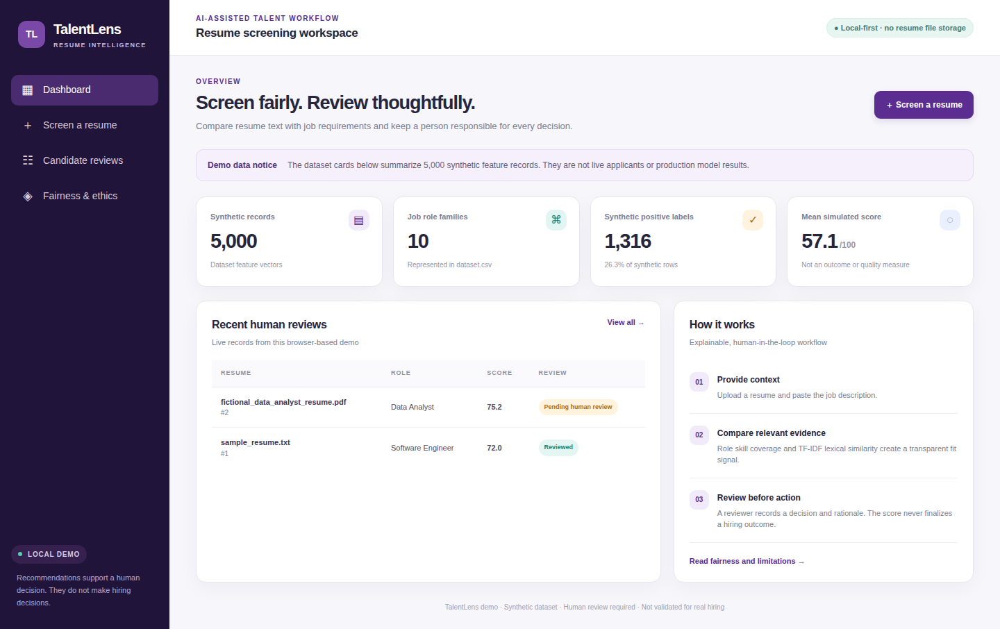
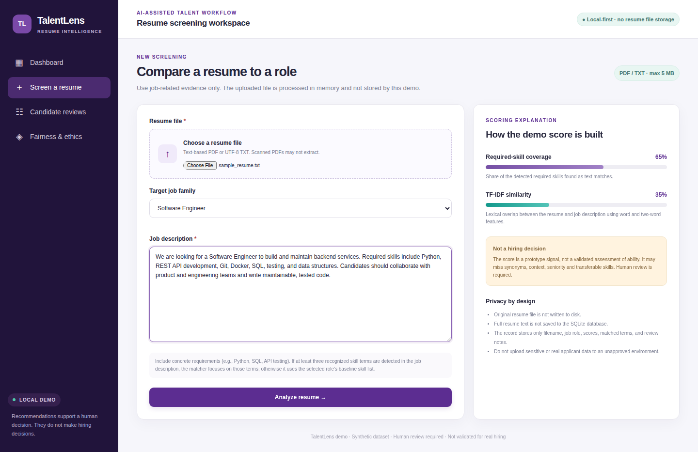
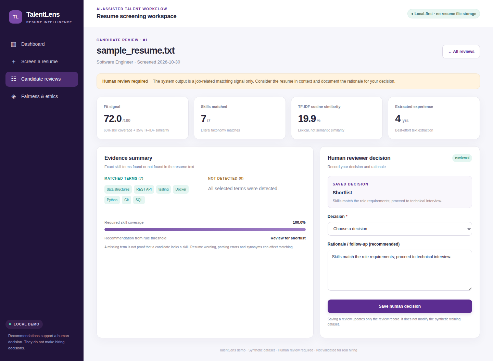
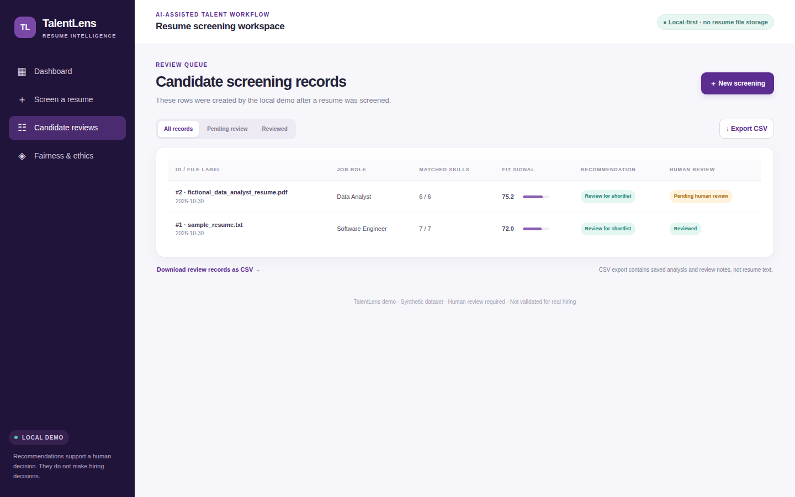

# TalentLens — AI-Based Resume Screening & Candidate Shortlisting

An academic Flask prototype for exploring job-related resume matching, transparent scoring, and human-in-the-loop candidate review. The repository includes a synthetic 5,000-row feature dataset, a complete data dictionary, EDA and baseline evaluation scripts, tests, and real screenshots of the running application.

> **Responsible-use warning:** This is a coursework prototype, not a validated hiring system. Do not use its score as the sole selection criterion or for consequential employment decisions. The dataset is synthetic; metrics learned from it do not establish real-world performance or fairness.

## Features

- Upload a text-based **PDF or TXT** resume and paste a job description.
- Extract text from PDFs in memory with `pdfplumber` (built on `pdfminer.six`).
- Compare detected job skills using a small, editable role taxonomy and literal skill matching.
- Compute TF-IDF cosine similarity between the resume text and job description.
- Show score components, matched skill terms, and terms not detected.
- Record a **human reviewer decision** and a rationale; a human can override the recommendation.
- Store review metadata in local SQLite without persisting the uploaded file or full resume text.
- Export saved review records to CSV.
- Access a stateless JSON scoring endpoint (`POST /api/score`) and health endpoint (`GET /api/health`).
- Run EDA visualizations and a separate scikit-learn baseline experiment on synthetic feature data.

## Tech stack

Python 3.10+, Flask, pandas, scikit-learn, pdfplumber, SQLite, Matplotlib, HTML/CSS, and `unittest`.

## Run locally

### 1. Create and activate a virtual environment

**Windows PowerShell**

```powershell
py -3.11 -m venv .venv
.\.venv\Scripts\Activate.ps1
python -m pip install --upgrade pip
pip install -r requirements.txt
```

**macOS / Linux**

```bash
python3 -m venv .venv
source .venv/bin/activate
python -m pip install --upgrade pip
pip install -r requirements.txt
```

### 2. Start the application

```bash
python app.py
```

Open <http://127.0.0.1:5000>.

### 3. Try the sample

Open **Screen a resume**, upload `examples/sample_resume.txt`, choose **Software Engineer**, and paste the contents of `examples/sample_job_description.txt` into the job-description field. Inspect the score components, then choose a human review decision and enter a brief rationale.

### 4. Run checks and analysis

```bash
python -m unittest discover -s tests -v
python eda.py
python train_baseline.py
```

Generated artifacts are written to `outputs/`:

- `eda_summary.json` — schema/range checks and summary statistics
- `eda_role_distribution.png`
- `eda_shortlist_balance.png`
- `eda_score_by_label.png`
- `eda_correlation.png`
- `baseline_metrics.json`
- `baseline_confusion_matrix.png`

## How scoring works

The live app does **not** apply the synthetic-data classifier. It uses an explicitly described, adjustable prototype formula:

`fit signal = 65 × required-skill coverage + 35 × TF-IDF cosine similarity`

Required-skill coverage is the share of selected skill terms that are literally detected in the resume text. When at least three known skill terms are detected in the job description, the scorer uses those terms; otherwise, it falls back to the selected role's baseline skill vocabulary. TF-IDF cosine similarity is a lexical similarity measure, not semantic understanding.

A score of 65 or greater triggers a **review-for-shortlist recommendation** in the UI. That threshold and the 65/35 weights are illustrative settings and need validation before any real-world use. A missing word does not prove a candidate lacks a skill; synonyms, context, spelling, document layout, and parsing quality can all affect the result. The UI always requires a separate human decision.

The extracted experience count is best-effort and informational only; it does not currently affect the fit signal.

## Dataset notes

`data/dataset.csv` preserves the eight-column schema requested in the project brief:

`resume_id, job_role, years_exp, skills_matched, education_score, keyword_density, predicted_score, shortlisted`

The file has 5,000 synthetic feature rows across ten role families. It combines the 500 supplied rows with 4,500 additional synthetic rows. The source's original records/labels are retained, so not every row necessarily follows the same score-to-label relationship. No real resume text or direct personal identifier is present in this CSV.

`data/data_dictionary.csv` describes every dataset column.

### Baseline training caution

`train_baseline.py` trains a logistic regression classifier to illustrate a reproducible train/test pipeline. The script deliberately excludes `predicted_score` from its features because the synthetic target-generation process is related to that field. Metrics are still only a technical demonstration on a synthetic split, not evidence of suitability for hiring. The classifier is not called by the live upload flow.

## API

### Health check

```bash
curl http://127.0.0.1:5000/api/health
```

### Stateless scoring

```bash
curl -X POST http://127.0.0.1:5000/api/score \
  -H "Content-Type: application/json" \
  -d '{"resume_text":"Software engineer with 4 years of experience in Python, SQL, Git and REST API development.","job_description":"Need Python, SQL, Git, testing and REST API experience for backend development.","job_role":"Software_Engineer"}'
```

The API does not persist the text or score. Avoid including real applicant information in debugging logs or test requests.

## Data and privacy behavior

- The browser upload is size-limited to 5 MB and accepts only PDF/TXT extensions.
- The file is read in memory; its contents are not written to disk.
- The full extracted resume text is not stored in SQLite.
- The SQLite database stores a sanitized filename label, role, scores, skill terms, timestamp, and human review decision/notes.
- Reviewer notes and filenames can still contain personal data. Use fictional/sample material for this coursework demo and delete the local database when no longer needed (`instance/screening.db`).
- The Flask development server is for local development only. Do not expose it to the internet as-is.

## Fairness and ethical limitations

The dataset has no demographic group fields, so group-wise selection rates, false-positive/negative rates, or demographic parity cannot be measured from the included files. Do not infer protected attributes or create synthetic demographics merely to claim a fairness audit is complete. A properly governed, lawful and representative audit dataset plus qualified human oversight is needed for such an evaluation.

Before any real pilot, perform privacy/security review, validate job-related criteria, assess accessibility and disparate impact, document retention and appeals, and keep a meaningful human decision-maker accountable. See `docs/ETHICS_AND_LIMITATIONS.md`.

## Repository map

```text
app.py                         Flask application and JSON endpoints
src/screening.py               PDF extraction, skill matching, TF-IDF scoring
src/db.py                      SQLite persistence and review-decision helpers
templates/                     Responsive HTML/Jinja templates
static/css/style.css            UI styling
data/dataset.csv                Synthetic feature dataset (5,000 × 8)
data/data_dictionary.csv        Column definitions
examples/                       Fictional sample resume and job description
eda.py                          Dataset validation + 4 EDA visualizations
train_baseline.py                Synthetic baseline training and evaluation
tests/                           Automated tests
docs/                            Report, synopsis, architecture, and screenshots
outputs/                         Generated metrics and charts (after running scripts)
```

## Screenshots and report

`docs/screenshots/` contains real captures of the application running locally (`python app.py`, Flask development server) using only fictional test resumes, plus the architecture graphic and EDA figures. The report and synopsis PDFs are included under `docs/` as project documentation; Section 8 of the report lists the live-run checks.

| Dashboard | Screening form |
|---|---|
|  |  |
| **Candidate detail + human review** | **Review queue** |
|  |  |

## License

MIT License. See `LICENSE`.
